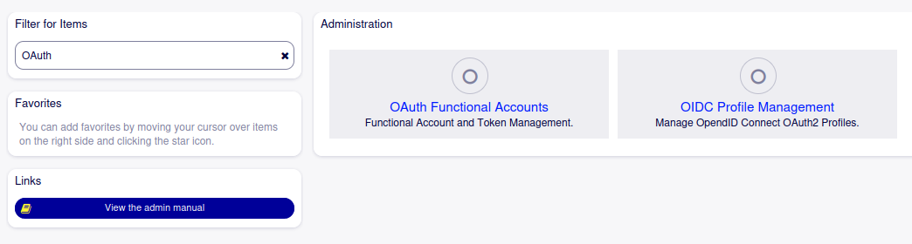
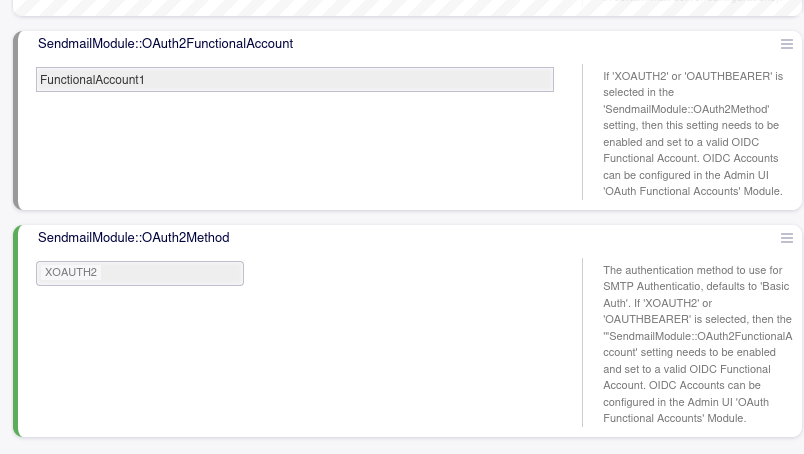
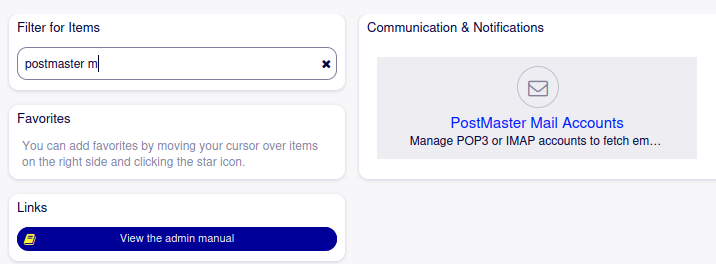
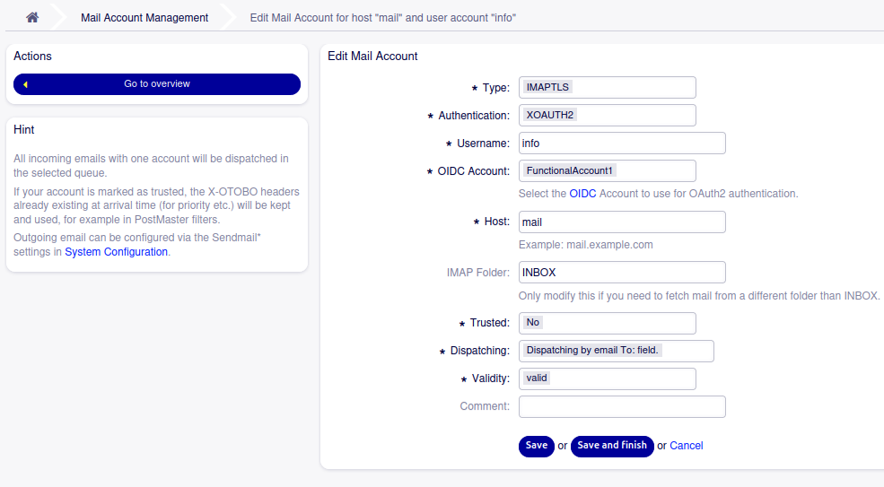

.. toctree::
    :maxdepth: 2
    :caption: Contents

Sacrifice to Sphinx
===================

Description
===========
Email sending (SMTP) and Email fetching (POP3/IMAP) using XOAUTH2/OAUTHBEARER.

System requirements
===================

Framework
---------
OTOBO 11.0.x

Packages
--------
OAuth2

Third-party software
--------------------
\-

Usage
=====

The OAuth2-Mail package allows to use the OAuth2 mechanisms XOAITH2 and OAUTHBEARER for authentication against email servers via the SMTP, POP3 and IMAP protocols.

Setup
=====

Regardless whether OAuth2 is used for sending or fetching email, a valid OAuth2 FunctionalAccount and its corresponding
OIDC provider settings need to be configured in the Admin UI. These can be set up using the 'OAuth Functional Accounts' and 'OIDC Profile Management' modules in the Admin UI, respectively.

Please refer to the OAuth2 package manual for more information on the options for setting up OIDC Profiles and/or OAuth2 Functional Accounts.

**Note**: On the OIDC Provider the Functional Account user must have the proper permissions assigned, as these will be specific to mail server and OIDC Provider used please 
refer to your email provider's instructions on how to setup authentication via OIDC.

**Note**: The Functional Account configured in Otobo will possibly need to have the proper OAuth2 scopes and/or resource ids configured specific to the mail server 
and OIDC Provider used. Again please refer to your email provider's documentation to determine the necessary settings.

SMTP
----

For ougoing email sending via SMTP, OAuth2 authentication has to be enabled in SysConfig under Core > Email:

- The SendmailModule setting must be one of the SMTP options. Choosing SMTPS or SMTPTLS is strongly recommended from a security perspective, do *not* use unencrypted SMPT with OAuth2 tokens in a production environment
- Make sure you use the proper SendmailModule::Port for the chosen SMTP method
- The SendmailModule::OAuth2Method setting must be set to either XOAUTH2 or OAUTHBEARER
- The SendmailModule::OAuth2FunctionalAccount setting must be set to the name of an OAuth Functional Account configured in the Admin UI as outlined above
- The SendmailModule::AuthUser must be set to the username of the FunctionalAccount that is used to send email
- The SendmailModule::AuthPassword will *not* be used with XOAUTH2 and/or OAUTHBEARER

POP3/IMAP
---------

For incoming email fetched via POP3 or IMAP, settings can be provided via the Admin UI Postmaster Mailaccounts module.

To enable XOAUTH2 or OAUTHBEARER For a given Postmaster mail account, do:    

- Change the authentication option from the default 'Basic Auth' option to either XOAUTH2 or OAUTHBEARER depending on your needs
- Select the Functional Account to be used for fetching email that you have configured above from the drop down list
- Specify the username of the FunctionalAccount that is used to fetch email

**Note**: Do *not* use unencrypted POP3 or IMAP protocols with OAuth tokens in a production environment. Always prefer to use the enrypted TLS or STARTTLS 
protocols for POP3 (POP3S or POP3TLS) or for IMAP (IMAPS or IMAPTLS).

Microsoft Specific
------------------

Prerequisites:

- MS Mailbox and User Account (m356) with username and password that has access to the mailbox
- An MS Identity Services OpenIDConnect OAuth2 Application with
  - OAuth2 ClientID
  - OAuth2 ClientSecret
  - the MS Entra (aka Azure AD) unique tenant name, eg 'otobo.onmicrosoft.com'
  - the OAuth2 AppID

First, configure an OIDC Profile for MS in Otobo

 - Profile Name  : unique name of your choice, eg 'microsoft'
 - Metadata URL  : https://login.microsoftonline.com/<TenantName, eg 'otobo.onmicrosoft.com'>/v2.0/.well-known/openid-configuration
 - Client ID     : from prerequisites above
 - CLient Secret : from prerequisites above

Note: Using v2.0 is recommended, but you can also use v1 by leaving out the version parameter for the Metadata URL and use
https://login.microsoftonline.com/<TenantName, eg 'otobo.onmicrosoft.com'>/.well-known/openid-configuration
instead. Note the necessary resource parameter in that case (see below), though!

Second, configure an OAuth2 FunctionalAccount for above Profile in Otobo

 - Account Name  : unique name of your choice, eg 'ms-email'
 - OIDC Profile  : Choose the Profile from above, eg 'microsoft'
 - GrantType     : password
 - Username      : the username from prerequisites above
 - Password      : the user password from prerequisites above
 - OAuth2 Scopes : offline_access https://outlook.office.com/IMAP.AccessAsUser.All https://outlook.office.com/SMTP.Send

Do not add other scopes, otherwise Email access will be denied.

If you used v1 as outlined above, you will also have to specify a resource parameter:

- reosurces      : https://outlook.office.com/

Alternatively, you can also use GrantType 'authorization_code'. In this flow you do not configure the user password in Otobo,
but your browser will be redirected to MS external authentication, and just an OAuth2 Token will be stored in Otobo. Use this
flow for example to support Multi Factor Authentication (MFA) with the user accessing the mailwerver.

SMTP
^^^^^^^^^^^^^^^^^^^^^^^^^^^^^^^^^^^^^^^^^^^^^^^^^^^^^^^^^^^^^^^^^^^^^^^^^^^^^^^^^^^^^^^^^^^^^^^^^^^^^^^^^^^^^^^^^^^^^^^^^^^^^^
Edit SysConfig -> Core -> Email and set the following settings

 - Sendmail::Module : SMTPTLS
 - SendmailModule::Host : outlook.office365.com or smtp-mail.outlook.com
 - SendmailModule::Port : 587
 - SendmailModule::AuthUser: the username from prerequisites above
 - SendmailModule::OAuth2Method : XOAUTH2
 - SendmailModule::OAuth2FunctionalAccount : Name of the OIDC FunctionalAccount configured in the second step, eg 'ms-email'

IMAP
^^^^^^^^^^^^^^^^^^^^^^^^^^^^^^^^^^^^^^^^^^^^^^^^^^^^^^^^^^^^^^^^^^^^^^^^^^^^^^^^^^^^^^^^^^^^^^^^^^^^^^^^^^^^^^^^^^^^^^^^^^^^^^
In the Admin UI go to 'Postnaster Mail Accounts' and add a new Mail Account

 - Type: IMAPS
 - Authentication: XOAUTH2
 - Username: the username from prerequisites above
 - OIDC Account: Name of the OIDC FunctionalAccount configured in the second step, eg 'ms-email'
 - Host: outlook.office365.com 
 - IMAP Folder: INBOX

 
https://learn.microsoft.com/en-us/exchange/client-developer/legacy-protocols/how-to-authenticate-an-imap-pop-smtp-application-by-using-oauth
https://learn.microsoft.com/en-us/entra/identity-platform/quickstart-register-app 
https://support.microsoft.com/en-us/office/pop-imap-and-smtp-settings-for-outlook-com-d088b986-291d-42b8-9564-9c414e2aa040

Configuration Reference
-----------------------

Core::Email
^^^^^^^^^^^^^^^^^^^^^^^^^^^^^^^^^^^^^^^^^^^^^^^^^^^^^^^^^^^^^^^^^^^^^^^^^^^^^^^^^^^^^^^^^^^^^^^^^^^^^^^^^^^^^^^^^^^^^^^^^^^^^^

SendmailModule::OAuth2FunctionalAccount
""""""""""""""""""""""""""""""""""""""""""""""""""""""""""""""""""""""""""""""""""""""""""""""""""""""""""""""""""""""""""""""
If 'XOAUTH2' or 'OAUTHBEARER' is selected in the 'SendmailModule::OAuth2Method' setting, then this setting needs to be enabled and set to a valid OIDC Functional Account. OIDC Accounts can be configured in the Admin UI 'OAuth Functional Accounts' Module.

SendmailModule::OAuth2Method
""""""""""""""""""""""""""""""""""""""""""""""""""""""""""""""""""""""""""""""""""""""""""""""""""""""""""""""""""""""""""""""
The authentication method to use for SMTP Authentication, defaults to 'Basic Auth'. If 'XOAUTH2' or 'OAUTHBEARER' is selected, then the '"SendmailModule::OAuth2FunctionalAccount' setting needs to be enabled and set to a valid OIDC Functional Account. OIDC Accounts can be configured in the Admin UI  'OAuth Functional Accounts' Module.

About
=======

Contact
-------
| Rother OSS GmbH
| Email: hello@otobo.io
| Web: https://otobo.io

Version
-------
Author: |doc-vendor| / Version: |doc-version| / Date of release: |doc-datestamp|
